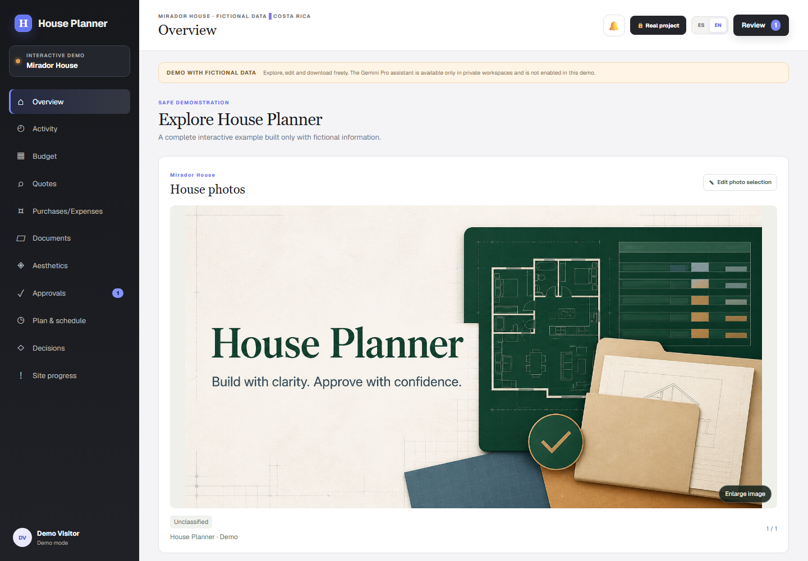
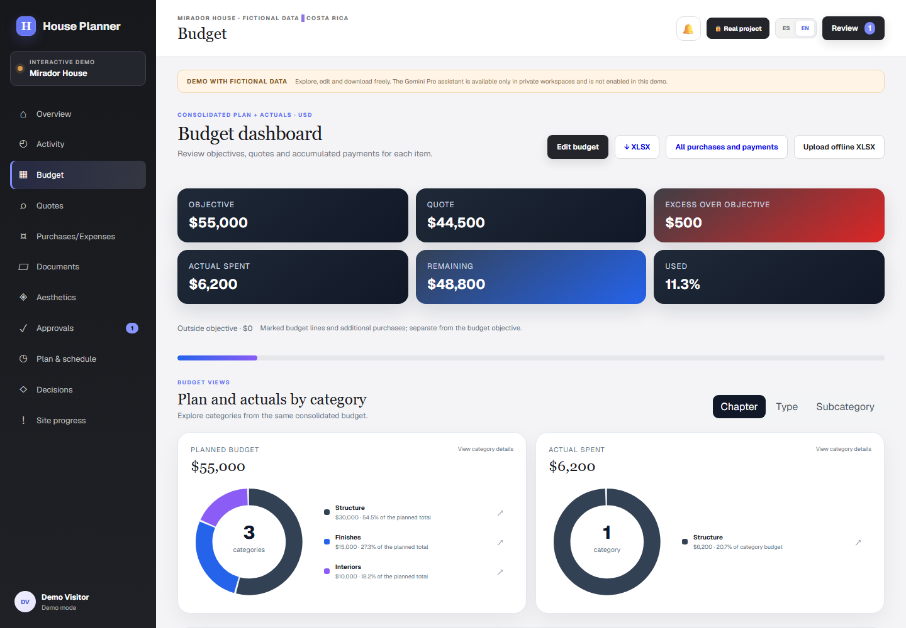
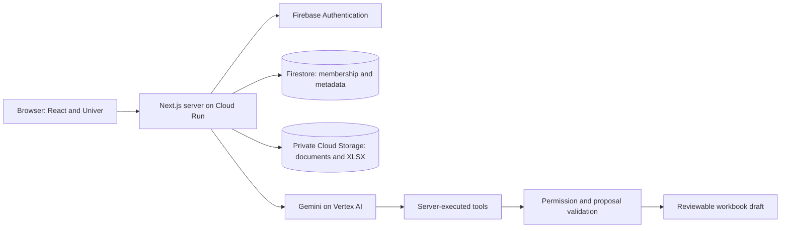

# House Planner

**A construction planning workspace with a permission-aware AI assistant and reviewable budget changes.**

[](https://github.com/carlosan1708/house-planner-portfolio/actions/workflows/ci.yml)
[](https://nextjs.org/)
[](https://www.typescriptlang.org/)
[](docs/development/sdd.md)

[Explore the synthetic demo](https://house-planner-prod-173941028457.us-central1.run.app/?mode=demo&lang=en)
 · [Architecture](docs/architecture/system.md)
 · [Development](DEVELOPMENT.md)
 · [SDD evidence](specs/002-portfolio-release/traceability.md)
 · [All documentation](docs/README.md)

Construction planning often spreads budgets, supplier offers, receipts, drawings, and decisions
across spreadsheets and messages. House Planner brings those workflows into one bilingual
application while preserving workbook fidelity, project ownership, and server-side permissions.

Built by [Carlos Andrés Rodríguez Trigueros](https://github.com/carlosan1708) as a working product
and an AI engineering case study: integrating a model is only one part of the problem. The
application also needs controlled context, validated proposals, recoverable edits, and safe releases.

> This is a curated public portfolio snapshot of an existing privately developed product. Original
> development history and production operations remain private. The hosted demo uses fictional data
> and requires no account; its assistant examples are scripted and make no live model calls.
> Source inspection is permitted. Running or reusing the project requires [prior written permission](LICENSE).

The public demo defaults to English and uses fictional **USD** amounts in its dashboards and
downloadable samples. Spanish remains available; changing the language preserves the amounts
and currency. Private project budgets and purchases keep their existing currencies.

Choose **USD** or **CRC** when creating a project, or update it under **Project settings**
as a project administrator. For an existing budget, explicitly confirm a denomination
correction: budget and payment numbers stay unchanged, a workbook version is created, and
older drafts must be reopened. Purchases and receipts retain their recorded currencies.
Currency is independent of language; legacy projects default to CRC. No exchange-rate
conversion is performed.



## What you can explore

Receipts can be uploaded independently and reused on payments with optional budget
assignment. Installments and balances feed calculated budget totals and supported
Excel downloads; [payment and receipt behavior](docs/payment-ledger.md) explains
historical balances and safe workbook round trips.

| Workflow | What the application does | Demo |
|---|---|---|
| Budget | Planned amounts, paid amounts, category dashboards, editable rows, XLSX downloads | Synthetic workbook |
| AI assistance | Searches permitted budget/document sources and proposes changes for review | Scripted sample responses |
| Supplier offers | Document packages, grounded comparisons, saved analysis and follow-up chat | Sample records |
| Documents | Nested folders, previews, access grants and encrypted folder boundaries | Fictional files |
| Design and site work | Moodboards, decisions, schedule and mobile capture | Sample content |
| Collaboration | Project memberships, private drafts, approval and activity history | Representative UI |
| Prepared 3D models | Source-linked geometry, uncertainty, corrections and export packages | Interactive fictional house |
| Furniture | Separate furnished proposals fitted to authorized room geometry | Selectable sample furniture |

Furniture has its own project tab and shares the existing Distribution permission and source checks.
Its illustrative pieces fit the authorized runtime room model, reserve known entrance routes and
back appliances and bathroom pieces onto modeled walls. Proposed furniture sizes are separate
from documented house measurements; the Distribution view remains unfurnished.

The interface supports English and Spanish. Private features remain permission-checked even
when users navigate directly to a section or file URL.



The budget dashboard shows the quote total between the objective and excess, excluding
items marked outside the objective. A project-specific quote-default rule fills empty or zero
quotes from each item's final objective on save; existing quotes and formulas are preserved.

## Engineering highlights

- **AI with controlled context.** Gemini on Vertex AI calls server-executed tools. Each tool
  checks the caller's access before reading budget lines, document excerpts, or opted-in notes.
  Encrypted documents stay outside plaintext AI integrations.
- **Keyless model authentication.** The server uses Google Application Default Credentials
  (ADC), backed by the attached Cloud Run service account in production. The
  [Gemini integration](lib/gemini.ts) requires no stored Gemini API key or downloaded
  service-account JSON key. Authentication stays on the server, outside browser code and model prompts.
- **Review before mutation.** Model output produces a validated proposal. Explicit confirmation
  creates a versioned workbook draft; the existing administrator/editor publication rules apply.
- **Spreadsheet fidelity.** ExcelJS conversion, stable line IDs, immutable draft snapshots,
  optimistic revisions and unsupported-feature detection protect the official workbook.
- **Authorization beyond the UI.** Project, section and folder checks run on server reads and
  writes. Platform-owner analytics and project administration have separate boundaries.
- **Operations with evidence.** Required CI runs static review, unit tests, compilation and applicable bounded Playwright. Full regression runs on request. Cloud QA is optional for every change and requires explicit approval of each defined session.
  Production promotion verifies the tested commit and tree rather than trusting a merged PR.

See the [assistant architecture](docs/architecture/assistant.md),
[workbook lifecycle](docs/architecture/workbooks.md), and
[security model](docs/architecture/security.md) for trade-offs and limitations.

## Architecture at a glance



The model does not receive independent database credentials. Tools and application routes
remain responsible for access checks and writes. [Read the system design](docs/architecture/system.md).

## Development approach: Spec-Driven Development

This portfolio preparation uses **GitHub Spec Kit 1.2.0 with Codex**. I defined the outcomes
and privacy constraints first, then recorded a technical plan, ordered tasks, and a consistency
review before changing the documentation, fixtures, and private preparation history.
The retained [SDD records](docs/development/sdd.md) describe that prior work; this public
repository starts with a new snapshot and does not include the original commit chronology.

| Stage | Reviewable artifact |
|---|---|
| Project principles | [Constitution](.specify/memory/constitution.md) |
| Requirements and clarified intent | [Specification](specs/001-portfolio/spec.md) |
| Decisions and implementation design | [Plan](specs/001-portfolio/plan.md) and [research](specs/001-portfolio/research.md) |
| Ordered work and consistency checks | [Tasks](specs/001-portfolio/tasks.md) and [analysis](specs/001-portfolio/analysis.md) |
| Requirement-to-change evidence | [Traceability](specs/001-portfolio/traceability.md) |
| Acceptance and remaining limits | [Validation](specs/001-portfolio/validation.md) and [convergence](specs/001-portfolio/convergence.md) |

Codex assisted with source research, planning, implementation and verification. I set the
requirements and scope, chose the approach, and retain responsibility for reviewing and accepting
the result. The artifacts explain decisions and recorded checks rather than treating generated
code as its own evidence.

The completed preparation lives in the private `codex/portfolio-sdd` archive; its records above
describe that original delivery. [Operational integration](specs/002-portfolio-release/spec.md)
has its own [plan](specs/002-portfolio-release/plan.md), [tasks](specs/002-portfolio-release/tasks.md),
[traceability](specs/002-portfolio-release/traceability.md) and [validation](specs/002-portfolio-release/validation.md).
Those archived records describe the private product. This public snapshot replaces installation
identifiers with examples and has no production deployment connection. See [snapshot provenance](docs/portfolio/snapshot.md).

Three [reconstructed design cases](docs/development/cases/README.md) explain the existing assistant,
workbook approval and encrypted-document workflows. They describe current code retrospectively;
they do not claim that those earlier features were originally developed with Spec Kit.

## Run locally with permission

Requires Node.js 22+ and npm. The following instructions are for the author and developers
who have obtained [written permission](LICENSE) to build or run a local copy.

```powershell
git clone https://github.com/carlosan1708/house-planner-portfolio.git
cd house-planner-portfolio
npm ci
Copy-Item .env.example .env.local
npm run dev
```

Open `http://localhost:3000/?mode=demo&lang=en`. The example configuration targets local synthetic
emulators and disables live AI. The public demo can render without starting them; authenticated
local tests require the [emulator workflow](docs/development/testing.md).

```powershell
npm run docs:check
npm run lint
npm test
npm run build -- --webpack
```

These are local checks, not proof of a live model evaluation or production release.
[Setup and configuration](DEVELOPMENT.md) explains the private-mode prerequisites.

## Technology

| Area | Tools |
|---|---|
| Application | Next.js 16, React 19, TypeScript |
| AI | Gemini / Vertex AI, typed server tools, permission-filtered text retrieval |
| Workbooks | Univer OSS and ExcelJS |
| Identity and data | Firebase Authentication, Firestore, Cloud Storage |
| Hosting and automation | Cloud Run, GitHub Actions, PowerShell release tooling |
| Validation | Vitest, Playwright, offline documentation checks |
| Development method | GitHub Spec Kit, Codex, Git |

## Evidence, privacy and rights

[Testing](docs/development/testing.md) distinguishes unit, mocked browser, emulator and cloud QA.
[History preparation](docs/operations/history-migration.md) explains the local rewrite and why
previous release evidence cannot authorize deployment of rewritten commits.

The public examples, workbooks, screenshots and house model are synthetic. This repository
contains a fresh source snapshot; private commit objects, original branches, PRs, deployment
credentials and recovery artifacts are not imported. [Snapshot provenance](docs/portfolio/snapshot.md)
and the [sanitation report](docs/portfolio/sanitation.md) describe the review boundary.

**License: permission required.** You may inspect the source and evaluate the author-hosted demo.
Copying or reusing the application, building or running a separate copy, modifying, redistributing
or deploying it requires prior express written permission from
[carlosan1708@gmail.com](mailto:carlosan1708@gmail.com). See the [LICENSE](LICENSE).
GitHub platform rights and [third-party licenses](THIRD_PARTY_NOTICES.md) remain applicable.
[Report security concerns privately](SECURITY.md).
