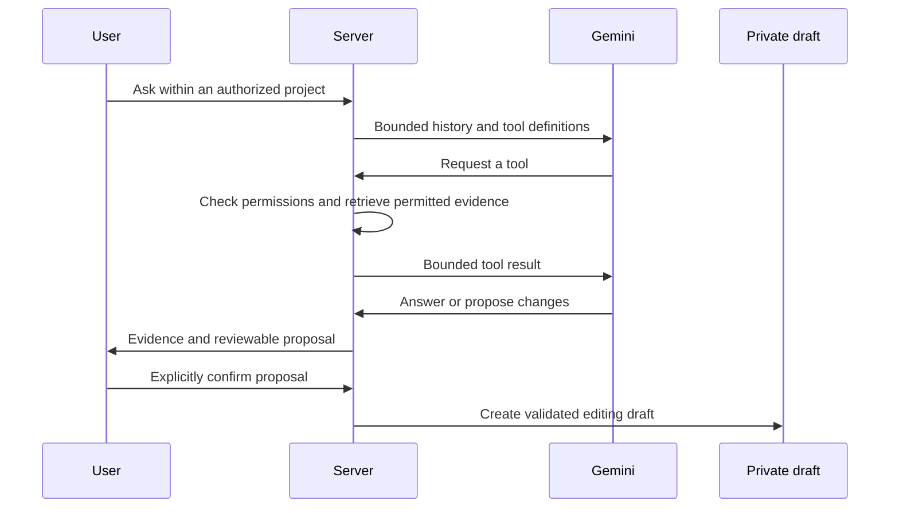

# Permission-aware AI assistant

The private assistant uses Gemini on Vertex AI through [the model adapter](../../lib/gemini.ts).
It is not enabled in the public demo. Live model access requires the operator's own authorized
cloud configuration; local regression tests do not establish model accuracy.

The adapter authenticates with Google Application Default Credentials (ADC). In Cloud Run,
ADC uses the service account attached to the running service, with short-lived credentials.
No Gemini API key or downloaded service-account JSON key is required. These credentials
remain server-side and are not included in browser code or model prompts.

## Request and context flow

1. [The chat route](../../app/api/assistant/chat/route.ts) checks the account and project context;
   anonymous read links cannot invoke it. Conversations belong to a project and user.
2. [runAssistantTurn](../../lib/assistant-service.ts) loads bounded conversation history and sends
   the model declared tools. Tools execute on the server and recheck applicable permissions.
3. Budget tools search official lines. [Document retrieval](../../lib/document-index.ts) filters
   authorized ordinary PDF/DOCX files, searches extracted text and returns bounded lexical excerpts.
   This implementation does not use a vector database or perform OCR on scanned documents.
4. Notes are shared within a project and protected by Notes permission. Authorized editors and
   administrators can opt individual notes into AI context; opt-out removes prior note-based
   replies from subsequent model context. Notes are not author-only records.
5. Responses can cite returned evidence. A proposed budget change is stored separately for review.
   Explicit confirmation creates a draft; publication follows normal project rules.

## Safeguards and limits

[Proposal validation](../../lib/assistant.ts) accepts known rows and whitelisted editable fields,
checks amounts and text bounds, and rejects unsupported targets. [Draft confirmation](../../lib/assistant-drafts.ts)
checks context and base revisions. Confirmation is not official publication.

Encrypted documents remain excluded from search and other plaintext integrations even after an
administrator unlocks them. Folder moves, access changes and note opt-out change what fresh tools can retrieve.

The current conversation-history filter revalidates note citations only. Previously generated
document or budget replies are not rechecked against later folder/section permission changes
or encryption moves before entering a subsequent model turn. Fresh retrieval remains guarded;
do not interpret that as complete permission revalidation of historical answers.

The service currently bounds tool rounds and output size. Grounding instructions and citations
help review; they do not guarantee correct reasoning, complete retrieval or resistance to every
instruction embedded in a source. SSE delivery chunks a completed application response and should
not be described as provider-token streaming.

## Evidence

[Assistant unit tests](../../tests/assistant.test.ts) exercise matching, language and proposal validation.
[Public-link guards](../../tests/public-link-api-guards.test.ts) exercise API denial before model calls
or draft writes. [Notes tests](../../tests/project-notes-route.test.ts) cover context opt-out.
[Draft UI tests](../../tests/budget-draft-workflow.test.tsx) verify opening an assistant-created draft.
These checks use deterministic/mocked boundaries, not a measured live-model evaluation.

See the [reconstructed design case](../development/cases/assistant.md).
