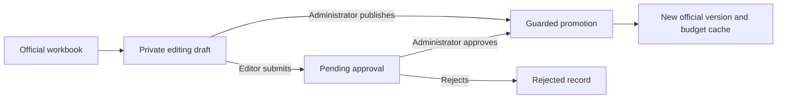

# Workbook edits, approval and publication

The official XLSX is the planned-budget authority. ExcelJS reads and writes it; Univer provides
advanced browser editing. Stable line IDs survive supported edits and map generated category
worksheets back to official rows. Unsupported workbook features disable unsafe browser editing.

The project stores its authoritative USD or CRC denomination; legacy projects default to CRC.
Official reads, imports, generated categories and payment exports apply that currency and preserve
it in hidden workbook metadata. Uploaded formatting or metadata cannot change project settings.
Administrators may change an untouched starter project's currency directly. Once financial
work exists, an explicitly confirmed denomination correction versions the workbook and changes
project payment denomination atomically while preserving every monetary number and formula.
Source revisions and transaction guards reject concurrent stale writes; existing drafts and
proposals must be reopened. Separately denominated purchases, receipts and immutable activity
retain their original currency. No exchange-rate conversion is performed.

Corrections commit atomically for up to 300 payment records and 5,000 rows per worksheet.
Larger projects or workbooks with unsupported features are rejected before any settings or
financial records change; an uncommitted prepared workbook is removed.

## Lifecycle

1. [Draft creation](../../app/api/workbook/drafts/route.ts) snapshots the current official workbook
   and records base plan/actuals revisions. Draft objects belong to a project and author.
2. Saves write immutable snapshot objects and use optimistic revisions to reject stale or frozen drafts.
3. Editors submit a computed diff and pending approval. Administrators can publish their draft directly.
4. Publication applies supported changes, writes a candidate XLSX, and updates version/config/cache
   metadata in the guarded transaction. Failed promotion does not silently become official.
5. [Approval handling](../../app/api/approvals/route.ts) checks administrator authority, project,
   pending state and the submitted draft before applying its reviewed changes.

## Concurrency and trade-offs

[Draft rules](../../lib/drafts.ts) prevent stale saves and mutation after submission. Direct
publication validates plan and actuals revisions. The approval transaction checks the current
plan revision but does not explicitly mirror the same loaded actuals revision comparison;
the two paths must not be described as having identical concurrency coverage.

Recoverable snapshots, XLSX candidate objects and cache synchronization add complexity. The benefit
is preserving private work and reporting conflicts rather than overwriting a shared workbook.
Google Sheets integration remains optional; see [its setup and offline workflow](../google-sheets-editing.md).

## Evidence

[Draft concurrency tests](../../tests/permissions-navigation-drafts.test.ts) cover stale saves,
frozen drafts and stale publication bases. [Approval diff tests](../../tests/approval-diff.test.ts)
separate edits from recalculated values. [Draft UI tests](../../tests/budget-draft-workflow.test.tsx)
cover save recovery, administrator publication and editor submission.

See the [reconstructed design case](../development/cases/workbook-approval.md).
