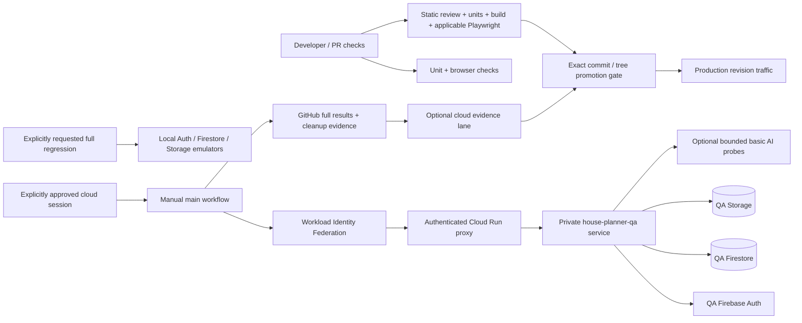

> Public snapshot note: the procedures below describe the private product's QA design.
> This repository has no configured cloud QA trust or deployment access. Its manual cloud
> workflow provides configuration guidance only. Written permission and independent setup
> are required for separate installations; see [snapshot provenance](portfolio/snapshot.md).

# QA architecture and operation

QA prioritizes server-enforced permissions and data isolation while covering application features. Default to local synthetic checks and standard trusted CI for every change. Cloud QA is always optional under the author's [005 decision](../specs/005-optional-cloud-qa/spec.md). Production data is never a writable test fixture. Fix a discovered bug in code and retest it against synthetic data; obtain the user's approval before repairing or changing production data.

## Three different meanings of environment

| Term | Purpose | Isolation boundary |
|---|---|---|
| GitHub environment `serverless-qa` | Workflow secrets, variables, and protection rules | Controls CI credentials; creates no cloud resources |
| Google Cloud project `house-planner-qa-example` | QA Cloud Run, Firebase Auth, Firestore, Storage, IAM, and basic Vertex AI | Separate resources and service identities from production `example-house-planner` |
| House Planner projects `qa-primary` and `qa-isolation` | Synthetic shared workspaces used by role and isolation tests | Application-level authorization inside the separate QA database |

The project ID is a provisioning target, not evidence that setup has run. The setup script creates/verifies resources explicitly; successful setup and an actual deployment are required before the manual cloud workflow can work. The old `production-qa` GitHub environment and `QA Proyecto aislado` workspace used production resources. The new workflow does not target them, and future production deployments remove QA reset allowlists.



Cloud Run is IAM private in QA. The runner authenticates through WIF and an IAM-authenticated localhost proxy (`scripts/qa-cloud-proxy.mjs`); the original HTTPS service URL is still checked against the configured project. Runtime isolation checks verify the environment, database project, bucket, service, revision, and source commit/tree before fixture writes. The QA service account has access to QA resources only. No production service-account key, Gmail OAuth token, production Google Sheet, or real workbook is copied into QA.

## Synthetic identities

Six separately signed-in identities exercise concurrent roles without repeatedly changing one user's role:

| Identity | Main project role | Coverage |
|---|---|---|
| Owner | Administrator in `qa-primary` | Publish, approvals, access management, global analytics denial |
| Editor | Editor in `qa-primary` | Authorized mutations and drafts; administrator actions denied |
| Viewer | Viewer in `qa-primary` | Permitted reads; writes denied by API |
| Restricted | Restricted viewer in `qa-primary` | Section and nested-folder denial, direct API/download checks |
| Companion | Lifecycle user in `qa-primary` | Pending/rejected access, invitations, reusable read links, revocation |
| Outsider | Administrator in `qa-isolation` | Cross-project record, file, folder, and mutation denial |

Anonymous requests and separate personal workspaces provide additional negative cases. QA project administrators remain unable to view global platform analytics; positive analytics behavior is tested locally with mocked owner authorization and synthetic events. QA telemetry is excluded from production usage totals. Fixture setup/reset is limited to the two fixed shared workspace IDs and synthetic fixture identities. A second editor can be added later for more simultaneous editing scenarios; it is not necessary to provision another server.

## Automatic cheap checks

Run the mandatory standard checks on pull requests: documentation/static review, lint, unit tests and build (including TypeScript). Use scripts/ci-browser-scope.mjs to select bounded browser tests from the source diff. Full browser/emulator regression is manual and optional under the author's 009 decision. Cancel superseded runs, cache npm dependencies, and keep large failure artifacts briefly. Use Linux GitHub runners. GitHub Actions included minutes/artifact storage depend on the repository owner's plan; any overage is outside the Google Cloud QA budget.

```powershell
npm ci
npm run lint
npm test
# Applicable browser coverage is selected by standard CI.
npm run build
```

Local emulator QA uses the `demo-house-planner-qa` Firebase project, Auth/Firestore/Storage emulator hosts, `HOUSE_PLANNER_ENVIRONMENT=qa`, and synthetic fixture accounts. Do not load production `.env` values, production ADC/service-account credentials, or real project data into that process. QA runtime guards refuse a demo project when all required emulators are not configured.

With Firebase CLI, Java, and Playwright Chromium installed, the launcher starts loopback emulators and the local app, supplies synthetic passwords and source provenance, seeds the two fixture workspaces, runs the selected suite, and stops its processes:

```powershell
npm run qa:local                    # permissions and cross-project isolation first
npm run qa:local -- --suite=full    # all feature suites; cloud AI remains disabled
```

Set `QA_FIREBASE_CLI_PATH` to the Firebase CLI's `firebase.js` entry point if it is not installed in a standard local/global npm location. The launcher overrides inherited cloud credentials and production configuration; local success does not produce release promotion evidence. `.env.qa.example` documents the isolated variables for separately managed local sessions.

Emulators cover API behavior and authorization but do not prove deployed IAM, Cloud Run routing, Vertex availability, signed cloud downloads, or real Google OAuth/email delivery. Compatibility checks are available with `PLAYWRIGHT_COMPATIBILITY=1` after installing Chromium, Firefox, and WebKit; mobile layouts use Playwright device projects.

## Codex manual browser checks

For requested features, bug fixes, and important changes, offer a lightweight local Codex-led browser smoke and focused exploratory check. The [manual browser QA plan](manual-browser-qa.md) defines triggers, role checks, short checklists, evidence, cleanup, and the required keep-open session setup. This complements Playwright and does not replace standard trusted CI or promotion evidence. A cloud browser session follows the separate approval rule below.

## Manual cloud regression

There is no scheduled cloud run. Cloud QA is optional for all changes, including server, permission and security changes. Offer it only when the user requests cloud testing or a specific substantial unresolved question cannot be verified locally. Explain that question and the evidence the cloud session would add; a server change, failed CI or deployment request alone does not justify an offer.

Before every defined session, record the exact source and target, scenarios, required setup/provision/build/deploy/regression/manual/AI operations, estimated duration and incremental cost, then ask for and obtain the user's explicit approval. General instructions to merge, deploy or test, existing resources and available budget are not approval. A CLI switch or workflow dispatch cannot prove human consent. Approval applies only to the defined session and its necessary cleanup; a new session or expanded scope requires a new decision. Do not silently retry or fall back to cloud after a failure. If declined, continue the authorized local checks and CI release with honest live-integration omissions.

Provisioning/deploying QA, reserving allowance and regression are distinct operations that must fit the approved session. Creating a serverless target does not authorize recurring cloud tests. Cleanup needed to restore that session's synthetic baseline, release its lease and stop processes remains covered by its original approval.

1. Run `scripts/setup-serverless-qa.ps1` for the QA project. Verify its plan/output and budget controls; no command targets `example-house-planner`.
2. Run `npm run qa:provision` to create/reuse the six synthetic identities, store passwords in the `serverless-qa` GitHub environment, and generate a separate QA vault recovery key. Provisioning uses an ephemeral impersonated QA token and does not create service account keys. Deploy the clean committed source with `npm run qa:deploy`; add `-- -EnableBasicAi` when the requested regression includes basic live AI. Prefer the final `main` commit to avoid repeating QA after a squash/rebase changes provenance. Cached commit images are reused by immutable digest; each new build attempt reserves its own allowance.
3. Configure GitHub environment `serverless-qa` variables: `QA_BASE_URL`, `QA_FIREBASE_PROJECT_ID`, `QA_WIF_PROVIDER`, and `QA_SERVICE_ACCOUNT`. Store six secrets: `QA_OWNER_PASSWORD`, `QA_EDITOR_PASSWORD`, `QA_VIEWER_PASSWORD`, `QA_RESTRICTED_PASSWORD`, `QA_COMPANION_PASSWORD`, and `QA_OUTSIDER_PASSWORD`. Emails come from the fixed synthetic fixture configuration.
4. Only after the session approval, open **Actions → QA regression → Run workflow** on `main`, choose the approved suite, and enter the exact deployed `source_commit` SHA (or use `main`'s default SHA). Explicitly choose `ai_mode=disabled` unless the approval includes the bounded basic live AI probes; choosing `basic` must be within that approved scope. Dispatch itself is not user approval.
5. Review the separate feature results, negative permission cases, cleanup result, and reported limitations. A successful full run with `ai_mode=basic` uploads `release-qa-evidence/release-qa-evidence.json` for the optional cloud release lane. Focused or AI-disabled runs remain diagnostics; they do not replace standard CI or authorize the cloud evidence lane.

The legacy workflow targeted production QA records and must not be re-enabled. Use only the guarded manual `qa-regression.yml` definition for an explicitly approved session. Setup and deployment never dispatch a cloud regression.

For the explicitly selected cloud evidence lane, the eight required suites run in this order: `permissions`, `core`, `expenses`, `distribution`, `notes`, `documents`, `aesthetics`, and `analytics`. Permissions and data isolation come first so a later AI-service failure cannot prevent their verification. They run serially to avoid shared fixture conflicts. Each signs in fresh, validates isolation, acquires a guarded expiring lease, and scopes cleanup to disposable QA data. Full evidence requires all eight suites and final cleanup to pass. Missing, duplicate, skipped, failed, or unexpected suites cannot authorize that cloud evidence lane. Focused tests and smoke tests remain useful diagnostics but cannot stand in for its full regression. These requirements do not make cloud testing mandatory for the CI lane.

Aesthetics assertions include image and PDF subfolders, inherited file formats, uploads that preserve curated selections, ordered cross-folder carousels, rename/reload persistence, protected Planos root operations, and atomic rejection of malformed, missing, or mixed-format selections. The permissions suite additionally checks foreign-project carousel IDs, folder mutations, and original/thumbnail downloads using the two administrator sessions; its disposable photos and folders are removed by their owning QA sessions. Missing-root recovery and corrupt legacy selections remain local unit/component cases, so cloud checks do not need to corrupt stored records.

The report records AI mode and checks omitted by cost policy. Extended assistant grounding, proposal generation, and live web search are outside the basic probe. Real Google Sheets/Drive OAuth and actual Gmail delivery require separately configured QA integrations and explicit approval; the standard cloud run does not prove those live services. Keep those limits visible instead of treating deterministic substitutes as end-to-end integration verification.

The basic quote probe submits three small readable offers in PDF, PNG, and DOCX formats. It requires each assigned supplier and its actual quoted amount, then checks the saved comparison and follow-up conversation. Supplier labels alone are insufficient evidence of document understanding. The application retains every submitted offer in the comparison; missing or ambiguous model findings are marked unverified with their submitted filenames, and an omitted supplier prevents a winner recommendation. This safeguard does not invent prices or replace the probe's amount checks.

For failures, inspect the workflow's logs and HTML/JSON/trace artifacts, fix code and retest locally. Do not start another cloud session without its explicit approval. Restore retained synthetic fixtures using the guarded cleanup suite within the original session's cleanup scope. Never run the production reset endpoint as recovery. Avoid recording passwords, sign-in tokens, or fixture credentials in uploaded artifacts.

## Cost target and early cutoff

The Google Cloud QA target is **USD $6.00 per calendar month**. A **USD $5.75 early cutoff** leaves a USD $0.25 buffer for delayed billing. It is a spending policy, not a guaranteed total invoice ceiling: service quotas, billing exports, budgets, and enforcement can lag. Resetting fixtures reduces future storage; it does not erase already incurred charges. Taxes and private-repository GitHub Actions charges are separate.

Controls combine zero minimum instances, request-based Cloud Run billing, one bounded QA instance, no periodic cloud regression, short workflow/request timeouts, small synthetic files, cleanup, image/build reuse, limited retained images, and basic AI limits. AI must remain disabled unless the user explicitly approves it within that session. Basic mode permits at most four live requests per run, forty per month, 24,000 measured input tokens and 3,072 total output/reasoning tokens per request. QA uses `gemini-3.1-flash-lite` on its supported global endpoint with minimal thinking, one text output candidate, and no automatic retries. Text, images, and PDFs are permitted; audio/video inputs and audio output are outside basic QA. Production model selection is independent. Server-side reservations count attempted calls, so rerunning a failed request cannot silently evade the quota. Review the provider's [model lifecycle](https://docs.cloud.google.com/gemini-enterprise-agent-platform/models/model-versions) before future model changes.

`scripts/qa-budget-control.mjs` reserves estimated costs in a durable, generation-checked Cloud Storage ledger before builds and regressions. Monthly limits are eleven builds and ten requested regressions, with a USD $0.50 base allowance and a USD $5.75 forecast cutoff. Reservation amounts are conservative estimates, not current billing totals; there is no guarantee that the ledger contains a fresh reported cost. A retry with the same reservation ID is idempotent; fixture resets do not erase reservations. Stored schema, fixed prices, timestamps, counts, and monthly rollover are validated before an allowance is reused. Concurrent writers retry against the latest generation and preserve each other's reservations; persistent conflicts fail closed.

A budget increase requires its own explicit user approval. Before changing the existing total budget in place, deploy the QA handler that recognizes both the old USD $5.50/5 and new USD $6.00 budget names and amounts. Preserve the existing project filter, notification topic and service spend caps; setup refuses to migrate an older total automatically. Do not reset or replace the existing reservation ledger.

The USD $6.00 total budget sends signed Pub/Sub notifications to a QA-only handler. When the reported cost reaches USD $5.75, the handler records a current-month cutoff and disconnects billing **only for the fixed QA project**. The handler and reservation ledger use the same cutoff constant. Pub/Sub publishes regular cost updates independently of the budget's email alert threshold rules, so this cutoff does not require changing those rules or the USD $6.00 budget. QA AI leases also reject that stored cutoff. A separate USD $3 Cloud Run spend cap and USD $0.50 Vertex spend cap apply to those eligible services and can restart automatically in a fresh month. The overall billing cutoff needs an explicit operator action to re-enable QA after the month changes; setup refuses to silently reconnect disabled billing. These controls can be delayed by billing/reporting and do not guarantee an exact invoice ceiling. See [Google's budget notification contract](https://docs.cloud.google.com/billing/docs/reference/budget/rest/v1/billingAccounts.budgets#notificationsrule).

The webhook verifies the Google JWT audience and exact budget push service account. It acknowledges permanently malformed signed messages without writes, ignores stale months, and returns retryable errors for failed control writes or billing disconnection. A later lower reported amount does not clear an existing current-month cutoff.

At a cutoff, stop cloud tests and continue locally. Re-enable overall QA billing only after a fresh month or an explicitly approved budget change. Deleting billing history or resetting fixtures must not reopen a spent allowance.

Inspect costs after the first requested full run and adjust caps or the budget only with the user. Keep fixture storage small and remove disposable files. Retain enough reports to investigate failures while avoiding large video/trace retention on every successful run.

## Production promotion evidence

The default promotion lane accepts standard trusted CI from the normal main merge, using
`-ValidationMode ci -CiRunId <main-CI-run-id>`. See [release gates](operations/releases.md#private-product-release-design)
for backup, candidate, current production baseline and exact-source prerequisites.

When the optional cloud evidence lane was explicitly selected, promotion accepts its trusted
GitHub run ID, not a local report path:

```powershell
powershell -ExecutionPolicy Bypass -File ./scripts/deploy-gcp.ps1 `
  -PromoteRevision house-planner-prod-REVISION `
  -ValidationMode cloud `
  -QaRunId 123456789
```

`scripts/release-qa.mjs` fetches the workflow, run, source Git commit, and artifact from authenticated GitHub APIs. It checks the repository, active workflow path, manual `main` dispatch, successful conclusion, workflow file blob, run attempt, full suite results, basic live AI coverage, declared integration limitations, cleanup, and evidence age (at most seven days). The workflow may explicitly check out a candidate SHA, but its evidence must name the exact candidate commit/tree while the main workflow commit is independently bound to GitHub's run metadata. The trusted workflow file at the run commit must match the candidate's release workflow file.

For that explicitly selected cloud lane, `scripts/deploy-gcp.ps1` then independently reads the deployed isolated QA revision through Google Cloud. It verifies readiness, QA service/project/environment, and exact candidate source commit/tree. The production candidate tree must equal current `origin/main`, and its exact tested commit must already be an ancestor of `origin/main`. A squash/rebase that produces another commit requires deployment and testing of the final commit. A tree match alone is insufficient. Only then does the script route production traffic.

This gate protects release provenance, not data migration approval. Production data repairs still require the user's approval even after QA finds a bug. The implementation and QA setup do not themselves deploy, merge, or mutate production.

## Releases without an isolated cloud regression

The [CI release lane](operations/releases.md#public-ci) is the default
for all ordinary code changes, including server, permission and security behavior. It retains
source-specific standard CI, meaningful boundary tests, applicable bounded Playwright,
backup, candidate, normal merge and exact-tree promotion checks. Trusted workflow and deployment
control changes still require explicit review of those controls.

No build or regression reservation is made in the QA project for CI validation. Existing
reservations, limits, service caps and webhook behavior are not reset or altered. A declined
cloud offer does not block an otherwise valid CI release. Report omitted live cloud/model/email/Sheets
checks rather than claiming those scenarios passed. Completed 001–003 records retain their
original policy and evidence; 005 documents the later author-approved rule.
